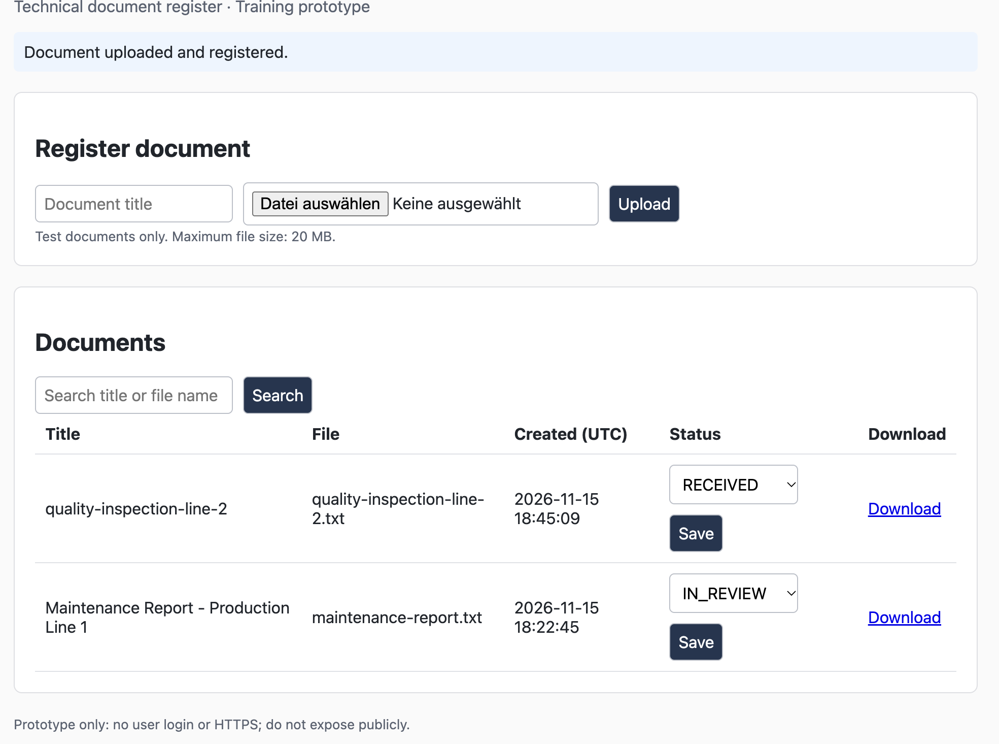
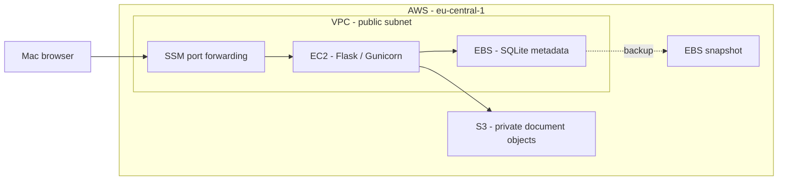

# DocuWorks | AWS Document Management Platform

**DCI Final Project — Cloud Infrastructure / Implementation**  
**AWS Region:** `eu-central-1` (Frankfurt)  
**Project status — 15 November 2026:** Working AWS prototype; recovery, monitoring and full deployment automation are still in progress.

## Project overview

DocuWorks is based on a DCI scenario: a small document-processing company with 10–20 employees wants to move away from a single physical server. Today, the application and uploaded files share the same machine, backups are manual, and a server failure can interrupt operations.

My goal is a **small, cost-conscious AWS foundation** that separates application runtime, persistent metadata and document files. I built a working document-register prototype to test this design. This is a demonstration of the proposed migration architecture, **not a migration of real customer data or an existing production application**.

## Working implementation | 15 November 2026



The application currently supports document upload, search, download and status changes (`RECEIVED`, `IN_REVIEW`, `PROCESSED`). The screenshot shows two synthetic production-line reports processed through the application running on AWS.

During the weekend implementation, I:

- Provisioned **18 AWS resources** with Terraform (`18 added, 0 changed, 0 destroyed`).
- Set up Amazon Linux 2023 on an EC2 `t3.micro` instance with Python 3.12, Flask, Gunicorn and a `systemd` service.
- Formatted and mounted a separate encrypted 8 GB EBS volume for SQLite application metadata.
- Connected document uploads and downloads to a private, versioned and encrypted S3 bucket using the EC2 IAM role.
- Accessed the application from my Mac via SSM port forwarding, without opening inbound SSH or HTTP ports.
- Verified that the EBS mount, SQLite data and S3 documents remained available after an EC2 restart.
- Created an EBS snapshot and confirmed its status as `completed`. **Restoration has not yet been tested.**

### Deployment evidence

| Evidence                                                                   | What it demonstrates                                                                      |
| -------------------------------------------------------------------------- | ----------------------------------------------------------------------------------------- |
| [EC2 instance](evidence/2026-11-15/02-ec2-instance.png)                    | The instance was deployed and deliberately stopped after testing to reduce compute costs. |
| [S3 document objects](evidence/2026-11-15/03-s3-documents.png)             | Two uploaded test documents exist in the private S3 bucket.                               |
| [EBS snapshot](evidence/2026-11-15/04-ebs-snapshot.png)                    | A snapshot of the separate application-data volume reached `completed`.                   |
| [Application screenshot](evidence/2026-11-15/01-docuworks-application.png) | The browser-based workflow and document statuses.                                         |

See [the test record](tests/test-plan.md) and [the implementation log from 15 November](progress/2026-11-15.md) for more detail.

## Why an industrial document workflow?

My previous work involved automated production processes, monitoring, technical fault analysis and operational handovers. I chose **fictional maintenance and quality-inspection reports** as sample documents because I know why these records matter in practice.

For example, a pressure fluctuation on a production line may lead to a sensor inspection and a maintenance report. The report needs to be stored, retrieved and marked with its current review status. If the application server restarts, the document and its metadata must still be available.

This shapes the project priorities: **reliable storage, clearly separated responsibilities, recoverability and understandable operations**. DocuWorks is not an industrial control system, and the current prototype does **not** provide a complete audit trail or approval workflow.

## Architecture and technical decisions

The implemented foundation uses **EC2 + EBS + S3**, provisioned with Terraform.



_Simplified view of the working proof of concept, not the final AWS architecture diagram._

| Component        | Why I chose it                                                                                       | Accepted trade-off                                                               |
| ---------------- | ---------------------------------------------------------------------------------------------------- | -------------------------------------------------------------------------------- |
| **EC2**          | Runs a small Linux application without requiring a serverless rewrite.                               | OS maintenance and a single point of failure.                                    |
| **EBS + SQLite** | Straightforward persistent metadata storage for a low-traffic, single-instance prototype.            | EBS is Availability Zone-specific; SQLite is not a multi-instance database.      |
| **S3**           | Keeps uploaded documents separate from the application server.                                       | Versioning alone is not a complete backup or recovery strategy.                  |
| **IAM + SSM**    | EC2 accesses S3 without static access keys; administration and demo access require no inbound ports. | SSM port forwarding is not a normal employee-facing access solution.             |
| **Terraform**    | Creates a repeatable AWS infrastructure foundation.                                                  | Linux bootstrap, EBS mounting and the application service are not yet automated. |

I also considered a serverless alternative using API Gateway, Lambda, DynamoDB and S3. I selected the EC2-based design because this assignment emphasizes a practical infrastructure migration, storage separation and recovery with limited time and operational complexity.

Read the [architecture comparison](architecture/comparison.md), [both design options](architecture/architecture-diagrams.md) and [Architecture Decision Records](decisions/) for the underlying reasoning.

## Tests and verified results

| Test                                           | Result                                                                                       |
| ---------------------------------------------- | -------------------------------------------------------------------------------------------- |
| `terraform init`, `validate` and `apply`       | **Passed** — 18 resources created                                                            |
| Automated Flask application tests              | **Passed** — 3 local tests                                                                   |
| Document upload and download                   | **Passed** — content verified                                                                |
| Document status update                         | **Passed** — tested in the browser                                                           |
| Document search                                | **Implemented** — covered by local application tests; separate AWS browser test not recorded |
| EBS mounting after EC2 restart                 | **Passed**                                                                                   |
| SQLite metadata and S3 documents after restart | **Passed**                                                                                   |
| Gunicorn / `systemd` and local HTTP request    | **Passed** — HTTP 200                                                                        |
| EBS snapshot creation                          | **Passed** — snapshot completed                                                              |
| Restore from snapshot / instance replacement   | **Not yet tested**                                                                           |
| CloudWatch logging and monitoring              | **Not yet implemented**                                                                      |

These tests demonstrate persistence after a **restart**, not yet successful recovery after **loss or replacement** of the server.

## Repository structure

| Directory                                      | Contents                                                              |
| ---------------------------------------------- | --------------------------------------------------------------------- |
| [`requirements/`](requirements/)               | Business requirements, technical requirements and assumptions         |
| [`architecture/`](architecture/)               | Architecture options, service analysis, comparison and draft diagrams |
| [`decisions/`](decisions/)                     | Four Architecture Decision Records (ADRs)                             |
| [`terraform/`](terraform/)                     | AWS network, compute, IAM and storage resources                       |
| [`application/`](application/)                 | Flask document register and storage integration                       |
| [`tests/`](tests/)                             | Automated application tests and verification record                   |
| [`evidence/2026-11-15/`](evidence/2026-11-15/) | Screenshots from the working AWS deployment                           |
| [`progress/`](progress/)                       | Implementation log, current status and next steps                     |
| [`presentation/`](presentation/)               | Final presentation material (pending)                                 |

## Run the application locally

From the repository root, with a suitable Python version (Python 3.12 used on EC2):

```bash
python3 -m venv .venv
source .venv/bin/activate
python -m pip install -r application/requirements.txt
python application/app.py
```

Open `http://127.0.0.1:5000`. The local default stores SQLite data and test documents in `./var/`, rather than S3. Use synthetic test files only.

Automated application tests:

```bash
python -m unittest discover -s tests -p 'test_*.py' -v
```

For infrastructure validation, see [`terraform/README.md`](terraform/README.md). **The current Terraform configuration provisions the AWS foundation, but does not yet reproduce the full manual Linux/application setup.** Never commit Terraform state, AWS credentials or actual customer documents.

## Security, limitations and next steps

This is a **controlled proof of concept**, not a production-ready document platform. The current implementation has no employee accounts, authentication, CSRF protection or public HTTPS endpoint. The EC2 instance has a public IPv4 address for outbound connectivity, but its security group allows **no inbound connections**. The browser demo uses an authorized SSM tunnel to the application's loopback interface.

The next priorities are:

1. **Recovery:** Restore the EBS snapshot to a separate volume, verify the SQLite data and document the procedure.
2. **Monitoring:** Add CloudWatch metrics and central application/system logs.
3. **Reproducibility:** Automate EBS mounting, Python environment setup and the `systemd` service.
4. **Architecture and security review:** Final AWS-icon diagram, access strategy, security checks, cost assessment and Well-Architected trade-offs.
5. **Final verification and cleanup:** Rerun the tests, document the results and remove chargeable demo resources after the project demonstration.

Cost matters for this small-company scenario. The EC2 instance was stopped after the test session; EBS, snapshots and S3 may still incur charges. No recovery success, high availability or complete production access solution is claimed at this stage.
