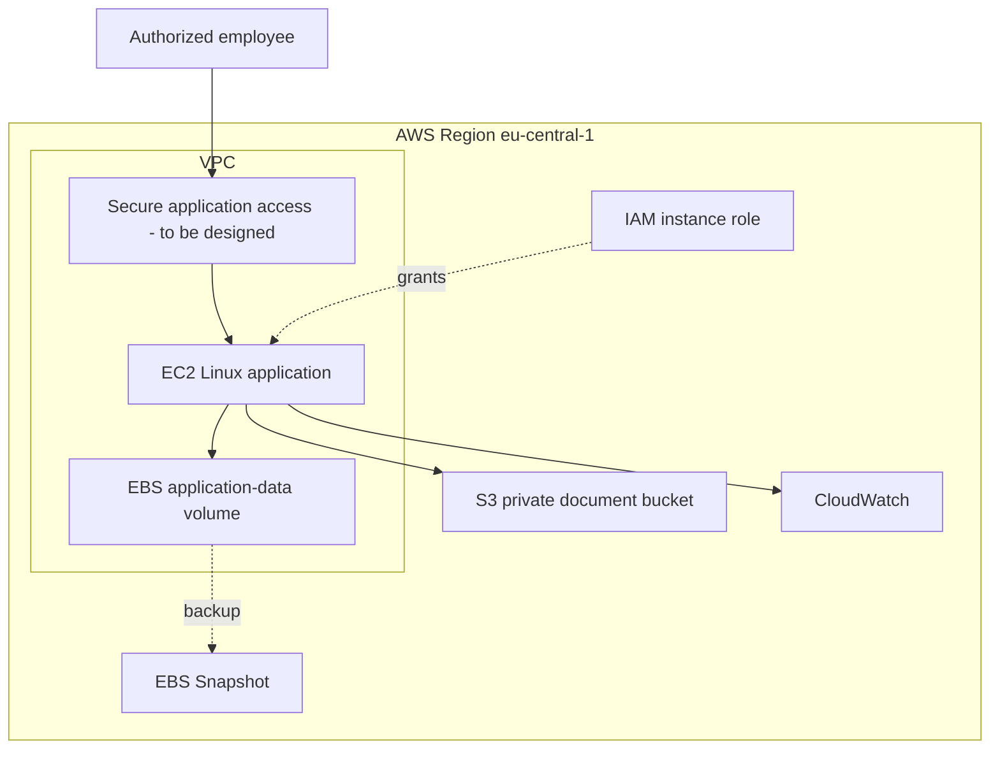
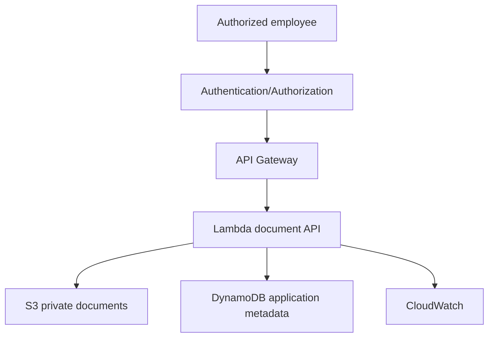

# Architecture alternatives — draft diagrams

Diagrams describe **design options**, not an existing AWS deployment.

## Option A — EC2 / EBS / S3

## Option B — Serverless redesign

## Final architecture diagram
**Not final yet.** Replace this section with a diagram of actual deployed resources, accurate subnets/security boundaries, storage and recovery flow once Week 3 implementation is complete.
